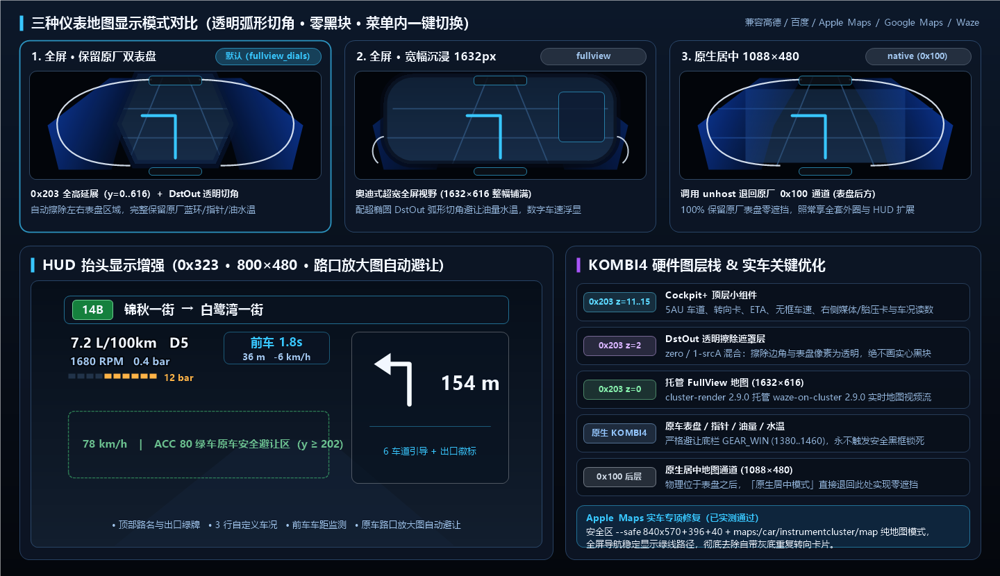

# Cockpit+ for BMW iDrive 7 (`id7_cockpit_plus`)

**BMW iDrive 7 (MGU / KOMBI4 液晶仪表 + HUD 抬头显示) 全屏导航与数字驾驶舱套件**  
[简体中文](#简体中文) | [English](#english)

---

<a id="简体中文"></a>

## 简体中文

> [!NOTE]
> **实车验证状态**：核心 `FullView 1632px` 地图投屏（高德地图、Apple Maps 全程路线与纯地图去重补丁）、5AU 车道引导、居中转向卡、ETA 胶囊、右侧媒体卡片及简体中文菜单已在 **BMW G20（iDrive 7 `MGU P18_23w44.2-1-3` + KOMBI4 仪表 + CarPlay）** 上实测跑通；`v0.9.9` 将透明切角遮罩直接嵌入 `cluster-render 2.9.1` 视频着色器内部（使用 GLSL `discard` 与硬件透明混合，彻底解决叠加层把原车表盘抹黑的问题），并新增数字车速防重影自动隐藏逻辑。在车机安装/调试前请做好配置备份，切勿卸载 `mgu-store` 与 `mgu-deploy` 等基础组件。


**Cockpit+** 是一套完全开源、只读 UDS 采集的 BMW iDrive 7 座舱增强套件。在车机 **MGU Store** 中添加单一开源软件源 `Hyperionism/idrive7-cockpit-plus`，即可一站式安装 `1632px` FullView CarPlay / Android Auto 投屏组件与原生简体中文（`zh-CN`）仪表/HUD 增强界面。

### 核心功能一览

- **三种零遮挡地图显示模式**（支持高德地图 / 百度地图 / Apple Maps / Google Maps / Waze）：
  1. **`全屏地图 · 保留原厂双表盘 (fullview_dials`，默认)**：通过 `0x203` 将地图延展至仪表顶部边缘（`y=0..616`），并由 `cluster-render 2.9.1` 在**地图视频着色器内部执行 `discard` 镂空与透明羽化混合**，从像素写入阶段就避开左右双表盘区域，**既全高显示大地图，又 100% 原样保留原厂时速/转速双环、指针与油量/水温表**。
  2. **`全屏地图 · 宽幅沉浸 1632px (fullview)`**：奥迪式超宽视野铺满中央区域，配合超椭圆视频着色器透明弧形切角避让油量、水温与底栏，居中车速（自动仅在此模式下显示，避免重影）与右侧卡片直接浮显于地图上。
  3. **`原生居中地图 1088×480 (native)`**：自动调用 `unhost` 退回硬件后层通道 `0x100`，位于原厂表盘之后 100% 零遮挡，同时照常保留全部外圈数据与 HUD 增强。
- **Apple Maps 实车专项优化**：通过 `--safe 840x570+396+40`（`280×190 pt @3x`）与纯地图模式 `maps:/car/instrumentcluster/map`（`itemType 1`），开始路线导航时稳定显示全程路径且不弹出苹果自带重复灰底卡片。
- **驾驶舱核心小组件（`panel 0x203`，严格避让 `GEAR_WIN 1380..1460` 安全区）**：
  - ① **5AU 顶部居中车道引导条**（`lane_guidance`）：支持 CarPlay / 高德 / 百度双层实时车道与推荐箭头。
  - ② **居中 iOS 转向提示卡**（`guidance_turn_card`）：支持路名与绿色高速出口徽标，触发距离可在菜单设置 `200m / 350m / 500m / 800m / 导航全程常显`。
  - ③ **居中无框数字车速 + 工况双行**（`speed` + `below_speed`）：支持油耗 / 电耗、实时功率 / 转速 / 涡轮增压值，每行可独立关闭或切换无框/半透明底板。
  - ④ **右侧多功能卡片（方向盘 BC 键循环切换）**（`right_widget`）：高清专辑封面媒体卡、行程与动力总成、四轮飞梭胎压胎温与智能异常警报、插混充电完成时间预估。
  - ⑤ **底部 ETA 到达胶囊**（`eta_pill`）：实时预计到达时间、剩余时间与剩余里程，未导航时自动隐藏。
  - ⑥⑦⑧ **外圈车况与底栏读数**：左下角发动机机油温度（冷机蓝字预警）与冷却液/波箱油温；档位 `D1–D8` 紧贴原车 `D` 旁且严格保证 `x ≥ 1461`；车内温度（随制冷/制热自动变色）；只读 DSC 液压刹车力度条/插混回充条；右下角 12V 电瓶 `% / 电压` 与混动 HV 电量显示。
- **HUD 抬头显示增强（`0x323`）与自由坐标微调工作室**：
  - 顶部通栏路名与高速出口绿牌、3 行只读车况、前车车距与相对速度、右侧矢量转向箭头与 6 车道引导（原车路口放大图弹出时自动避让 `y ≥ 202` ACC 区）。
  - 车机内设 **9 个清晰分类菜单**，内置 **组件自由位置微调工作室（`LAYOUT_POS`）**：可选 `2 / 10 / 30 px` 步长，对转向卡、车道条、ETA 胶囊、数字车速、外圈读数与 HUD 自由调 X/Y 坐标。



### 套件组件与版本

| 组件名 | 类型 | 版本 | 说明 |
| :--- | :--- | :--- | :--- |
| **`cluster-render`** | 工具 | `2.9.1` | RAMSES 19 + Dcsm2 仪表与 HUD 合成器，支持 `1632x720`、`host_layers` 与原生视频着色器透明切角 `host_mask`（基于 `robertnisipeanu/idrive-apps`） |
| **`waze-on-cluster`** | 工具 | `2.9.0` | FullView 全屏 CarPlay / AA 地图解码器（`1632x720`、`--safe 840x570+396+40`、Apple Maps 纯地图 `itemType 1`）与 HUD 投影 |
| **`robertn_waze_cluster`** | 应用 | `0.6.17` | *Maps on cluster* 车机控制界面（已适配识别 `1632x720` 全屏补丁状态） |
| **`mgu-render`** | 工具 *（可选）* | `0.6.26` | OpenGL ES 2 GPU 渲染守护进程（源自 `robertnisipeanu/mgu-store`） |
| **`cockpit-fullview`** | 工具 | `1.0.0` | 自动可逆修复旧版 `cluster-render.local.conf` 槽位冲突并禁用重叠原生 C++ 浮窗 |
| **`id7_cockpit_plus`** | 应用 | `0.9.9` | **Cockpit+ 主程序**：中文菜单、3 种零遮挡全屏/原生地图模式、着色器级透明切角、防车速重影、全套仪表与 HUD 控件及自由坐标微调 |

### 通过 MGU Store 安装（Releases 源）

1. 让车机连接手机热点或 Wi-Fi，打开车机 **MGU Store → Sources（软件源）**。
2. 选择 **Releases** 类型添加仓库源：
   ```text
   Hyperionism/idrive7-cockpit-plus
   ```
3. 刷新后安装 **`Cockpit+ 驾驶舱增强`（`id7_cockpit_plus`）**，商店会自动按依赖安装 `cluster-render`、`waze-on-cluster` 与 `cockpit-fullview`。
4. 再安装 **`Maps on cluster`（`robertn_waze_cluster`）** 以管理 CarPlay / Android Auto 投屏补丁。
5. 长按中控音量旋钮约 30 秒重启一次 iDrive 即可生效。

> [!IMPORTANT]
> - 切勿卸载 **`mgu-store`** 和 **`mgu-deploy`**。
> - 如果此前曾通过第三方安装包/其他源安装过 `cluster-render`，请在 MGU Store 的 **Sources** 中**暂时仅保留 `Hyperionism/idrive7-cockpit-plus` 一个包含 `cluster-render` 的软件源**再点击安装/更新，即可平滑升级至 `2.9.1`。

### 本地构建、测试与桌面模拟器

```sh
# 1. 使用 stub-SDK 构建简体中文安装包
python3 vendor/cauliflowermossgrape-idrive7-apps/kit/tools/build.py --app-root . --language zh-CN --stub-sdk id7_cockpit_plus

# 2. 运行全部单元测试（核心 30 项 + 伴侣工具/中文包/Schema 2 目录 9 项）
REQUIRE_DIST=1 node test/run_tests.js
node test/fullview_companion_test.js

# 3. 启动本地桌面预览模拟器
npm run bench
```

---

<a id="english"></a>

## English

> [!NOTE]
> **Real-Vehicle Verified Base + New v0.9.9 Native Shader Mask**: Core `1632px` FullView CarPlay projection (AMAP & Apple Maps full-route with pure map-only `itemType 1`), 5AU lanes, centered turn card, ETA pill, right-wing media widget, and `zh-CN` UI have been verified on a physical **BMW G20 (iDrive 7 `MGU P18_23w44.2-1-3`, KOMBI4, CarPlay)**. `v0.9.9` moves the alpha cutout & GLSL `discard` directly into **`cluster-render 2.9.1`'s video fragment shaders** (eliminating black overlay occlusion against BMW's live swapchain dials), plus auto-hides the digital speed overlay whenever native dials are visible. Always back up configs and never uninstall `mgu-store` or `mgu-deploy`.


**Cockpit+** is an open-source, read-only UDS **BMW iDrive 7 (MGU / KOMBI4 + HUD)** FullView navigation and digital cockpit suite built for **MGU Store (Releases feed)**. Adding **`Hyperionism/idrive7-cockpit-plus`** provides every component needed for `1632px` CarPlay / Android Auto cluster projection together with calibrated cluster & HUD telemetry widgets.

### Key Features

- **Three Zero-Occlusion Cluster Map Modes**:
  1. **`FullView + Native Dials (fullview_dials`, default)**: Extends the hosted map to the top edge of `0x203` (`y=0..616`) while `cluster-render 2.9.1` evaluates a native GLSL `discard` & alpha feather directly inside its video shaders so BMW's live speedometer & tachometer rings, needles, and gauges are never overwritten.
  2. **`FullView Wide 1632px (fullview)`**: Full-width Audi-style cockpit projection across `1632x616`, paired with a smooth superellipse video-shader bezel cutout that clears the fuel/coolant sub-gauges and bottom status bar (digital speed overlay auto-enables in this mode).
  3. **`Native Center 1088x480 (native)`**: Calls `cr.unhost('map')` to return the map to hardware slot `0x100` **behind** BMW's stock dials for 100% zero dial occlusion while retaining all outer Cockpit+ and HUD overlays.
- **Apple Maps Pure Map-Only Route Fix**: Uses `--safe 840x570+396+40` (`280×190 pt @3x`) and `maps:/car/instrumentcluster/map` (`itemType 1`) so active Apple Maps routes stay rendered without duplicate grey turn cards.
- **Calibrated KOMBI4 Panel (`0x203`) & HUD (`0x323`) Widgets**:
  - **Navigation Overlays**: Dual-row **5AU lane guidance**, **iOS turn card** (`200m–800m` or always-on, with highway exit shield), and bottom **ETA capsule**.
  - **Powertrain, Media & Alerts**: Frameless **digital speed** + per-line **efficiency/RPM/boost** vitals, **BC-cyclable right-wing widget** (album art media, trip/powertrain, 4-wheel TPMS & smart anomaly alerts, PHEV charging finish prognosis), `D1–D8` gear strictly clear of `GEAR_WIN (1380..1460)`, HVAC-colored cabin temp, read-only DSC brake rail, and 12V/HV SoC.
  - **HUD (`0x323`) & Position Studio**: CJK street + green highway exit banner, lead-car headway (`1.8s / dist / delta`), 3-line vitals, vector HUD navigation that auto-yields on OEM intersection mini-maps, plus an in-car **Widget Position Studio (`2 / 10 / 30 px` free X/Y adjustment)**.


### Components

| Component | Kind | Version | Purpose |
| :--- | :--- | :--- | :--- |
| **`cluster-render`** | Tool | `2.9.1` | Shared RAMSES 19 + Dcsm2 cluster/HUD compositor with `1632x720`, `host_layers`, and native video-shader `host_mask` cutouts |
| **`waze-on-cluster`** | Tool | `2.9.0` | FullView CarPlay / AA H.264 decoder (`1632x720`, `--safe 840x570+396+40`, Apple Maps `itemType 1`) + HUD projection |
| **`robertn_waze_cluster`** | App | `0.6.17` | *Maps on Cluster* iDrive UI (updated to recognize `1632x720` FullView patching) |
| **`mgu-render`** | Tool *(optional)* | `0.6.26` | 60 fps OpenGL ES 2 GPU renderer daemon (from `robertnisipeanu/mgu-store`) |
| **`cockpit-fullview`** | Tool | `1.0.0` | Reversibly repairs conflicting `cluster-render.local.conf` overrides and disables overlapping native C++ pods |
| **`id7_cockpit_plus`** | App | `0.9.9` | **Cockpit+**: 3 map modes with shader-level transparent cutouts, 5AU lanes, turn card, ETA pill, right-wing widgets, HUD nav & Position Studio |

### Install via MGU Store (Releases Feed)

1. Connect the head unit to Wi-Fi / hotspot and open **MGU Store → Sources**.
2. Add a **Releases** source:
   ```text
   Hyperionism/idrive7-cockpit-plus
   ```
3. Install **`Cockpit+` (`id7_cockpit_plus`)** (auto-resolves `cluster-render`, `waze-on-cluster`, and `cockpit-fullview`) and **`Maps on cluster` (`robertn_waze_cluster`)**.
4. Reboot iDrive once (hold the volume knob for ~30 seconds).

### Local Build & Test

```sh
python3 vendor/cauliflowermossgrape-idrive7-apps/kit/tools/build.py --app-root . --language zh-CN --stub-sdk id7_cockpit_plus
REQUIRE_DIST=1 node test/run_tests.js
node test/fullview_companion_test.js
npm run bench
```

---

## Credits & License

- Built upon [`chyiz/idrive7-cluster-plus`](https://github.com/chyiz/idrive7-cluster-plus), [`cauliflowermossgrape/idrive7-apps`](https://github.com/cauliflowermossgrape/idrive7-apps), [`robertnisipeanu/idrive-apps`](https://github.com/robertnisipeanu/idrive-apps), and [`robertnisipeanu/mgu-store`](https://github.com/robertnisipeanu/mgu-store).
- `id7_cockpit_plus`, `waze-on-cluster`, `robertn_waze_cluster`: **GPL-3.0-only / GPL-3.0-or-later**
- `cluster-render` client/protocol/kit: **MPL-2.0**; service: **GPL-3.0-or-later**
- `mgu-render`: **GPL-3.0 / MIT**
