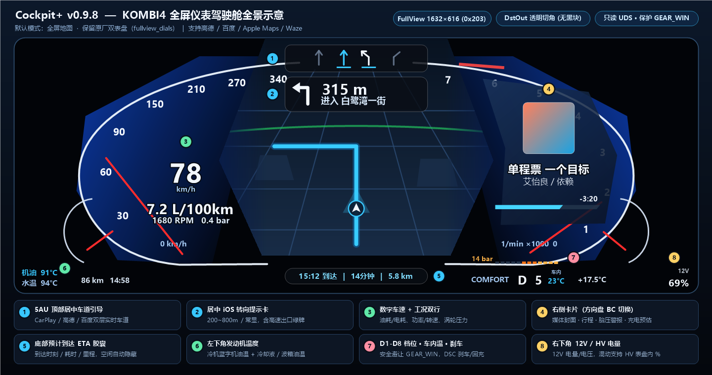

# Cockpit+ for BMW iDrive 7 (`id7_cockpit_plus`)

**BMW iDrive 7 (MGU / KOMBI4 液晶仪表 + HUD 抬头显示) 全屏导航与数字驾驶舱套件**  
[简体中文](#简体中文) | [English](#english)

---

<a id="简体中文"></a>

## 简体中文

> [!NOTE]
> **实车验证状态**：核心 `FullView` 地图投屏（高德地图、Apple Maps 全程路线与纯地图去重补丁）、转向卡、ETA 胶囊、右侧媒体卡片及简体中文菜单已在 **BMW G20（iDrive 7 `MGU P18_23w44.2-1-3` + KOMBI4 仪表 + CarPlay）** 上实测跑通；`v0.9.15` 优化了顶部 `340 / 100 / 7` 刻度区的渐变眉线，改为单调连续的平滑上眉渐隐（昼夜浅/深色地图下均无局部暗斑，保持左右对称与自然通透）；同时完整保留 **全屏融合双表盘 / 居中标准小地图（`0x203` 保留外圈与右卡）/ 纯原厂模式（`0x100` + 原厂 `0x200`）** 三模式切换、`y=120..600` 对称居中、**`28..160 px` 自定义表圈渐变宽度**、即时响应的 BC 按键与更易读的中文菜单。在车机安装/调试前请做好配置备份，切勿卸载 `mgu-store` 与 `mgu-deploy` 等基础组件。



**Cockpit+** 是一套完全开源、只读 UDS 采集的 BMW iDrive 7 座舱增强套件。在车机 **MGU Store** 中添加单一开源软件源 `Hyperionism/idrive7-cockpit-plus`，即可一站式安装 `1632px` FullView CarPlay / Android Auto 投屏组件与原生简体中文（`zh-CN`）仪表/HUD 增强界面。

### 核心功能一览

- **三种仪表地图显示模式**（支持 `68 / 96（默认）/ 130 px` 档位或 `28..160 px` 自定义渐变宽度）：
  1. **`全屏融合双表盘 (fullview_dials`，默认)`**：地图扩展至 `y=0..668`（下延至抬高的 ETA 胶囊背后，严格避让 `GEAR_WIN`），由 `cluster-render 2.9.6` 采用与多媒体专辑背景同源的 **KOMBI4 实车单应性标定外沿轮廓 + C1 连续平滑 SDF**，顶部沿 `340 / 100 / 7` 刻度区采用连续平滑上眉弧线渐隐过渡（白天/夜间地图均无突兀暗斑），同时保留完整外圈车况（车内温度自动避让公制 `+14.5°C`：燃油车位于 `x=1712`，混动位于 `x=1170`）、5AU 转向卡、ETA 胶囊与右侧多功能卡片。
  2. **`居中标准小地图 (center_panel)`**：无论行车（`mask_mode=2`，精准避让原车 `0 km/h`）还是熄火（`mask_mode=3`），始终统一在 `0x203` 渲染，**`y=120..600` 严格上下对称一致**，且全程保留右侧 BC 卡片、5AU 转向卡、ETA 胶囊与外圈数据。
  3. **`纯原厂模式 (native)`**：行车与熄火全程释放 `panel 0x203` 并交回原生 `0x100`，彻底回归原厂小地图与 **100% 原厂右侧 BC 卡片（`slot 0x200`）**（HUD `0x323` 仍正常增强工作）。
- **精简导航卡片不重复 & ETA 上移避让**：仪表端复用原厂底部车道栏，**顶部 5AU 区域放置 iOS 转向提示卡（`y=18`）**；**底部 ETA 胶囊默认上移 20 px 至 `y=628`**，熄火显示 `Total km` 总里程时不再重叠。
- **Cockpit+ 外圈读数稳固保留**：切换为 **`仅外圈车况读数 (map_only)`** 时，油温/水温、12V 电量、混动 HV 电量、刹车力度条、档位与车内温度保留在各自原生外圈位置（`0x203` 关闭右侧卡片与全屏托管）。
- **Apple Maps 实车专项优化**：通过 `--safe 840x570+396+40`（`280×190 pt @3x`）与纯地图模式 `maps:/car/instrumentcluster/map`（`itemType 1`），开始路线导航时稳定显示全程路径且不弹出苹果自带重复灰底卡片。
- **驾驶舱核心小组件（`panel 0x203`，严格避让 `GEAR_WIN 1380..1460` 安全区）**：
  - ① **顶部居中 iOS 转向提示卡**（`guidance_turn_card` at `5AU` pocket）：支持路名与绿色高速出口徽标，触发距离可在菜单设置 `200m / 350m / 500m / 800m / 导航全程常显`。
  - ② **居中无框数字车速 + 工况双行**（`speed` + `below_speed`）：支持油耗 / 电耗、实时功率 / 转速 / 涡轮增压值，每行可独立关闭或切换无框/半透明底板（居中地图模式下自动隐藏重绘车速以保留原车数字车速）。
  - ③ **右侧多功能卡片（方向盘 BC 键循环切换）**（`right_widget`）：高清专辑封面媒体卡、行程与动力总成、四轮飞梭胎压胎温与智能异常警报、插混充电完成时间预估。
  - ④ **底部 ETA 到达胶囊**（`eta_pill`, `y=628`）：实时预计到达时间、剩余时间与剩余里程，未导航时自动隐藏。
  - ⑤⑥⑦ **外圈车况与底栏读数**：左下角发动机机油温度（冷机蓝字预警）与冷却液/波箱油温；档位 `D1–D8` 紧贴原车 `D` 旁且严格保证 `x ≥ 1461`；车内温度（随制冷/制热自动变色）；只读 DSC 液压刹车力度条/插混回充条；右下角 12V 电瓶 `% / 电压` 与混动 HV 电量显示。
- **HUD 抬头显示增强（`0x323`）与自由坐标微调工作室**：
  - 顶部通栏路名与高速出口绿牌、3 行只读车况、前车车距与相对速度、右侧矢量转向箭头与 6 车道引导（原车路口放大图弹出时自动避让 `y ≥ 202` ACC 区）。
  - 内置 **组件自由位置微调工作室（`LAYOUT_POS`）**：可选 `2 / 10 / 30 px` 步长，对顶部转向卡、ETA 胶囊、数字车速、外圈读数与 HUD 自由调 X/Y 坐标。


### 套件组件与版本

| 组件名 | 类型 | 版本 | 说明 |
| :--- | :--- | :--- | :--- |
| **`cluster-render`** | 工具 | `2.9.6` | RAMSES 19 + Dcsm2 仪表与 HUD 合成器，支持 `1632x720`、`host_layers` 与实车标定 KOMBI4 表圈轮廓 + 平滑单调 `340/100/7` 上眉过渡 + 上下对称 `mask_mode=1/2/3` 着色器遮罩（基于 `robertnisipeanu/idrive-apps`） |
| **`waze-on-cluster`** | 工具 | `2.9.2` | FullView 全屏 CarPlay / AA 地图解码器（`1632x720`、`--safe 840x570+396+40`、`idle_ms=600000` 熄火保活）与 HUD 投影 |
| **`robertn_waze_cluster`** | 应用 | `0.6.17` | *Maps on cluster* 车机控制界面（已适配识别 `1632x720` 全屏补丁状态） |
| **`mgu-render`** | 工具 *（可选）* | `0.6.26` | OpenGL ES 2 GPU 渲染守护进程（源自 `robertnisipeanu/mgu-store`） |
| **`cockpit-fullview`** | 工具 | `1.0.0` | 自动可逆修复旧版 `cluster-render.local.conf` 槽位冲突并禁用重叠原生 C++ 浮窗 |
| **`id7_cockpit_plus`** | 应用 | `0.9.15` | **Cockpit+ 主程序**：三模式地图切换（全屏融合 / `0x203` 对称居中 / 纯原厂 `0x100`+`0x200`）、昼夜无暗斑平滑 `340/100/7` 眉线过渡、自定义 `28..160px` 渐变宽度、丝滑 BC 切换、公制车内温度避让、5AU 顶置转向卡、ETA 与 HUD 控件 |

### 通过 MGU Store 安装（Releases 源）

1. 让车机连接手机热点或 Wi-Fi，打开车机 **MGU Store → Sources（软件源）**。
2. 选择 **Releases** 类型添加仓库源：
   ```text
   Hyperionism/idrive7-cockpit-plus
   ```
3. 刷新后安装 **`Cockpit+ 驾驶舱增强`（`id7_cockpit_plus`）**，商店会自动按依赖安装 `cluster-render`、`waze-on-cluster` 与 `cockpit-fullview`。
4. 再安装 **`Maps on cluster`（`robertn_waze_cluster`）** 以管理 CarPlay / Android Auto 投屏补丁。
5. 长按中控音量旋钮约 30 秒重启一次 iDrive 即可生效。

> [!IMPORTANT]
> - 切勿卸载 **`mgu-store`** 和 **`mgu-deploy`**。
> - 如果此前曾通过第三方安装包/其他源安装过 `cluster-render`，请在 MGU Store 的 **Sources** 中**暂时仅保留 `Hyperionism/idrive7-cockpit-plus` 一个包含 `cluster-render` 的软件源**再点击安装/更新，即可平滑升级至 `2.9.6`。

### 本地构建、测试与桌面模拟器

```sh
# 1. 使用 stub-SDK 构建简体中文安装包
python3 vendor/cauliflowermossgrape-idrive7-apps/kit/tools/build.py --app-root . --language zh-CN --stub-sdk id7_cockpit_plus

# 2. 运行全部单元测试（核心 30 项 + 伴侣工具/中文包/Schema 2 目录 9 项）
REQUIRE_DIST=1 node test/run_tests.js
node test/fullview_companion_test.js

# 3. 启动本地桌面预览模拟器
npm run bench
```

---

<a id="english"></a>

## English

> [!NOTE]
> **Real-Vehicle Verified Base + v0.9.15 Smooth Monotonic `340/100/7` Brow Transition (`2.9.6`), Three Map Modes, Custom Feather & Smooth BC Cycling**: Core `1632px` FullView CarPlay projection (AMAP & Apple Maps full-route with pure map-only `itemType 1`), turn card, ETA pill, right-wing media widget, and `zh-CN` UI have been verified on a physical **BMW G20 (iDrive 7 `MGU P18_23w44.2-1-3`, KOMBI4, CarPlay)**. `v0.9.15` (`cluster-render 2.9.6`) replaces the detached elliptical top-halo with a smooth monotonic top-brow curve and uniform feathering across `340 / 100 / 7` (eliminating dark blotches on daytime light maps while staying clean and readable in both day and night modes), alongside three consistent map modes, symmetric Center Small Map (`y=120..600`), custom `28..160 px` bezel fade width, immediate jitter-free BC cycling, and clear `zh-CN` labels.


**Cockpit+** is an open-source, read-only UDS **BMW iDrive 7 (MGU / KOMBI4 + HUD)** FullView navigation and digital cockpit suite built for **MGU Store (Releases feed)**. Adding **`Hyperionism/idrive7-cockpit-plus`** provides every component needed for `1632px` CarPlay / Android Auto cluster projection together with calibrated cluster & HUD telemetry widgets.

### Key Features

- **Three KOMBI4 Map Modes** (`68 / 96 / 130 px` presets or custom `28..160 px` fade width):
  1. **`FullView Map (fullview_dials`, default)**: Extends the hosted map vertically across `y=0..668` while `cluster-render 2.9.6` evaluates a C1-continuous analytic SDF derived from `buildStockBackdrop`'s KOMBI4 outer bezel contour (`WING_TOP_Y` / `WING_OUTER_X` / `WING_BOTTOM_Y`) with a smooth monotonic brow transition across `340 / 100 / 7` (no daytime blotch), paired with all `0x203` outer vitals (including non-overlapping Metric `cabin_temp` at `x=1712` ICE / `x=1170` PHEV), 5AU turn card, raised ETA pill, frameless speed, and BC right-wing widget.
  2. **`Center Small Map (center_panel)`**: Stays consistently hosted on `panel 0x203` in both driving (`mask_mode=2`, `0 km/h` cutout) and engine-off (`mask_mode=3`) with strict top-bottom symmetry (`y=120..600`), keeping all `0x203` outer vitals, nav cards, and Cockpit+'s BC right-wing widget active.
  3. **`Pure Stock Map (native)`**: Releases `panel 0x203` and unhosts back to `slot 0x100` in both driving and engine-off so BMW's **genuine stock `0x100` map + `0x200` right BC card** run 100% natively while HUD (`0x323`) keeps running.
- **Outer Vitals Preservation**: Switching `clusterSlotMode` to **Outer Vitals Only (`map_only`)** keeps coolant/oil, 12V, HV SoC, brake rail, `D1–D8`, cabin temp, and below-speed telemetry in their original outer `0x203` positions while hiding the right widget and fullview host.
- **Apple Maps Pure Map-Only Route Fix**: Uses `--safe 840x570+396+40` (`280×190 pt @3x`) and `maps:/car/instrumentcluster/map` (`itemType 1`) so active Apple Maps routes stay rendered without duplicate grey turn cards.
- **Calibrated KOMBI4 Panel (`0x203`) & HUD (`0x323`) Widgets**:
  - **Navigation Overlays**: Top-center **iOS turn card** in the `5AU` pocket (`760, 18, 400x96`, `200m–800m` or always-on, with highway exit shield) + raised bottom **ETA capsule** (`760, 628, 400x46`, clear of `Total km`).
  - **Powertrain, Media & Alerts**: Frameless **digital speed** + per-line **efficiency/RPM/boost** vitals, **BC-cyclable right-wing widget** (album art media, trip/powertrain, 4-wheel TPMS & smart anomaly alerts, PHEV charging finish prognosis), `D1–D8` gear strictly clear of `GEAR_WIN (1380..1460)`, HVAC-colored cabin temp, read-only DSC brake rail, and 12V/HV SoC.
  - **HUD (`0x323`) & Position Studio**: CJK street + green highway exit banner, lead-car headway (`1.8s / dist / delta`), 3-line vitals, vector HUD navigation that auto-yields on OEM intersection mini-maps, plus an in-car **Widget Position Studio (`2 / 10 / 30 px` free X/Y adjustment)**.


### Components

| Component | Kind | Version | Purpose |
| :--- | :--- | :--- | :--- |
| **`cluster-render`** | Tool | `2.9.6` | Shared RAMSES 19 + Dcsm2 cluster/HUD compositor with `1632x720`, `host_layers`, calibrated KOMBI4 bezel SDF + monotonic `340/100/7` brow & symmetric `mask_mode=1/2/3` |
| **`waze-on-cluster`** | Tool | `2.9.2` | FullView CarPlay / AA H.264 decoder (`1632x720`, `--safe 840x570+396+40`, `idle_ms=600000` standby keep-alive) + HUD projection |
| **`robertn_waze_cluster`** | App | `0.6.17` | *Maps on Cluster* iDrive UI (updated to recognize `1632x720` FullView patching) |
| **`mgu-render`** | Tool *(optional)* | `0.6.26` | 60 fps OpenGL ES 2 GPU renderer daemon (from `robertnisipeanu/mgu-store`) |
| **`cockpit-fullview`** | Tool | `1.0.0` | Reversibly repairs conflicting `cluster-render.local.conf` overrides and disables overlapping native C++ pods |
| **`id7_cockpit_plus`** | App | `0.9.15` | **Cockpit+**: 3 map modes (FullView w/ monotonic `340/100/7` brow transition, symmetric `0x203` Center Small Map, Pure Stock `0x100+0x200`), custom `28..160px` fade, smooth BC cycling, 5AU turn card, ETA pill, HUD nav & Position Studio |

### Install via MGU Store (Releases Feed)

1. Connect the head unit to Wi-Fi / hotspot and open **MGU Store → Sources**.
2. Add a **Releases** source:
   ```text
   Hyperionism/idrive7-cockpit-plus
   ```
3. Install **`Cockpit+` (`id7_cockpit_plus`)** (auto-resolves `cluster-render`, `waze-on-cluster`, and `cockpit-fullview`) and **`Maps on cluster` (`robertn_waze_cluster`)**.
4. Reboot iDrive once (hold the volume knob for ~30 seconds).

### Local Build & Test

```sh
python3 vendor/cauliflowermossgrape-idrive7-apps/kit/tools/build.py --app-root . --language zh-CN --stub-sdk id7_cockpit_plus
REQUIRE_DIST=1 node test/run_tests.js
node test/fullview_companion_test.js
npm run bench
```

---

## Credits & License

- Built upon [`chyiz/idrive7-cluster-plus`](https://github.com/chyiz/idrive7-cluster-plus), [`cauliflowermossgrape/idrive7-apps`](https://github.com/cauliflowermossgrape/idrive7-apps), [`robertnisipeanu/idrive-apps`](https://github.com/robertnisipeanu/idrive-apps), and [`robertnisipeanu/mgu-store`](https://github.com/robertnisipeanu/mgu-store).
- `id7_cockpit_plus`, `waze-on-cluster`, `robertn_waze_cluster`: **GPL-3.0-only / GPL-3.0-or-later**
- `cluster-render` client/protocol/kit: **MPL-2.0**; service: **GPL-3.0-or-later**
- `mgu-render`: **GPL-3.0 / MIT**
